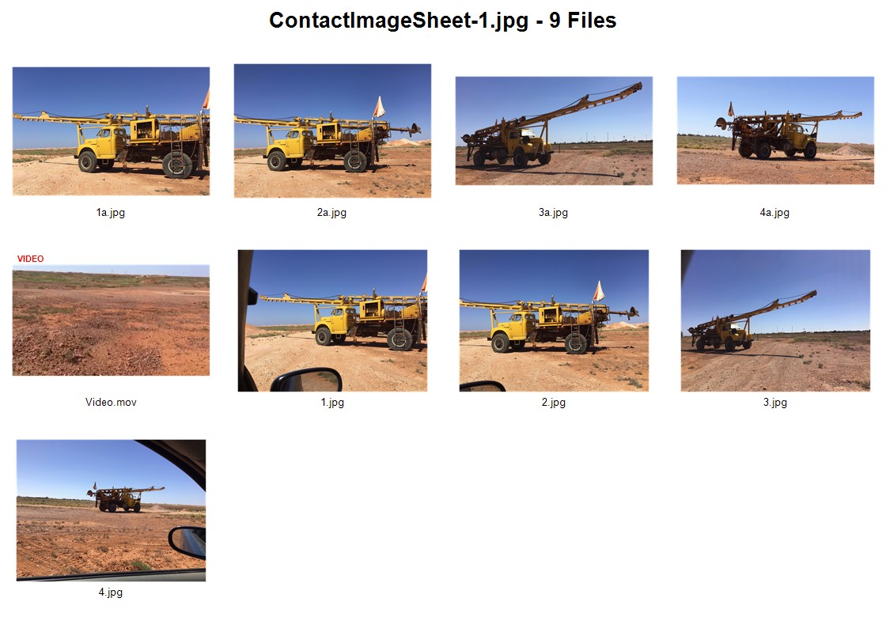

<p align="center">
  
</p>

# MediaMosaic

[](https://github.com/DanielBrownAG/MediaMosaic/actions/workflows/tests.yml)

Generate JPEG contact sheets from images and videos using PowerShell on Windows.
MediaMosaic recursively scans a media folder, corrects EXIF orientation, and lays
out previews with captions showing paths relative to the source folder. Large
collections are split into numbered sheets, with 200 files per sheet by default.

Use it to review project photography, audit mixed media collections, or prepare
a visual index for dataset review. Each run produces numbered JPEG sheets, a
CSV index, and a manifest for cleaning up obsolete sheets on subsequent runs.
Thumbnail caching is enabled by default to speed up repeat reviews of unchanged
collections, including video and WebP previews that would otherwise need FFmpeg.

## Quick start

```powershell
git clone https://github.com/DanielBrownAG/MediaMosaic.git
Set-Location MediaMosaic

# Image-only collections need no FFmpeg installation.
.\MediaMosaic.ps1 -RootFolder 'D:\Photos' -OutputFile '.\Review\ProjectPhotos.jpg'
```

Keep `MediaMosaic.ps1` and `MediaMosaic.psm1` together. The script loads the module
relative to its own location, so you can also invoke it from another directory.

## Requirements

- Windows with PowerShell 5.1 or PowerShell 7+ and `System.Drawing`.
- [FFmpeg](https://ffmpeg.org/download.html) for video and WebP previews. Ordinary
  image collections do not require FFmpeg. Use `ffmpeg` on PATH or pass its full
  executable path with `-FFmpeg`.
- Files must be locally readable. OneDrive and SharePoint synchronised files may
  need downloading before they can be decoded.

The regression suite has been run on Windows with PowerShell 5.1 and 7.6.9.
macOS and Linux are not supported by the current Windows drawing implementation.

## Usage

Run from PowerShell; there is no need to edit the source:

```powershell
.\MediaMosaic.ps1 -RootFolder 'D:\Photos' -OutputFile 'C:\Temp\ProjectPhotos.jpg'
```

The source directory must exist. Output directories are created automatically.
Paths are treated literally, including spaces, apostrophes, and square brackets.
Relative paths resolve against the current PowerShell filesystem location.
`RootFolder` is required; `OutputFile` defaults to `MediaMosaic.jpg` in the current
location. The output filename is a naming base: `.jpg` and `.jpeg` are accepted,
while generated sheets always use `.jpg`.

```powershell
.\MediaMosaic.ps1 -RootFolder 'D:\Photos[2026]' `
    -OutputFile '.\Review\Project.jpg' `
    -FFmpeg 'C:\Tools\ffmpeg\bin\ffmpeg.exe' `
    -FFmpegTimeoutSeconds 45 `
    -FilesPerSheet 100 -Columns 5 -ThumbWidth 240 -ThumbHeight 180
```

## Parameters

| Parameter | Default | Description |
| --- | --- | --- |
| `RootFolder` | Required | Directory scanned recursively |
| `OutputFile` | `MediaMosaic.jpg` | Base output path, ending in `.jpg` or `.jpeg` |
| `FFmpeg` | `ffmpeg` | Executable name on PATH or full executable path |
| `FFmpegTimeoutSeconds` | `30` | Shared FFmpeg time budget per video or WebP preview, including video fallback; 1–3,600 seconds |
| `NoProgress` | Off | Suppress progress reporting for scripts, logs, or CI |
| `CacheFolder` | `.mediamosaic-cache` inside the output directory | Dedicated folder for reusable PNG thumbnails |
| `NoCache` | Off | Bypass cache reads and writes; overrides `RefreshCache` |
| `RefreshCache` | Off | Rebuild previews for the current inputs instead of reading existing entries |
| `FilesPerSheet` | `200` | Maximum input files per sheet; 1–100,000 |
| `Columns` | `4` | Grid columns; 1–1,000 |
| `ThumbWidth` | `250` | Thumbnail box width in pixels; 1–10,000 |
| `ThumbHeight` | `180` | Thumbnail box height in pixels; 1–10,000 |
| `HeaderHeight` | `60` | Header height in pixels; 1–10,000 |
| `TextHeight` | `30` | Caption height in pixels; 1–10,000 |
| `Padding` | `15` | Cell padding in pixels; 0–1,000 |

All numeric options are validated. Each sheet is limited to 100 million pixels
and 65,500 pixels per side to reject excessive allocations before creating the
canvas. Smaller cell dimensions can clip text; allow sufficient header and
caption space for readable output. The canvas contains only the required rows.

## Supported media and preview failures

- Images: JPG, JPEG, PNG, BMP, GIF, and WebP.
- Videos: MP4, MOV, AVI, and MKV.

JPG/JPEG, PNG, BMP, and GIF use Windows image decoding. EXIF rotations and mirrored
orientations are corrected when orientation metadata is present. GIFs use their
initial frame. WebP previews are decoded by FFmpeg.

Videos use a frame at approximately three seconds. If that extraction fails or
produces no frame, MediaMosaic retries at the beginning, so short clips still
have a preview. Video cells carry a red **VIDEO** label. FFmpeg runs without
interactive input; its exit status, output file, and diagnostics are checked.
Each preview has a 30-second FFmpeg budget by default, shared between the initial
attempt and any fallback. Change it with `-FFmpegTimeoutSeconds`. A stalled decoder
is terminated when the budget expires; the cell becomes `PREVIEW FAILED`, its
timeout is recorded in the warning and CSV, and the next input is processed.
The budget limits FFmpeg execution, not native Windows image decoding or all
filesystem operations.
Temporary preview files are removed and image/drawing resources are disposed
on both success and failure.

A corrupt or unreadable file with a supported extension keeps its grid position and
caption with a **PREVIEW FAILED** placeholder. Missing FFmpeg affects only media
that require it. Each failed preview emits a warning with the path and error;
processing continues. Headers show separate rendered and failed counts.
Files with extensions outside the supported list are ignored during discovery.

## Thumbnail caching

By default, previews are saved as scaled, aspect-fitted PNGs in
`.mediamosaic-cache` alongside the output sheets. A warm run reuses these images
without decoding the original media again. Sheets, headers, captions, and the CSV
are still regenerated, so changes to pagination or layout take effect immediately.

Cache keys include the source's absolute path, byte size, UTC modification time,
thumbnail width/height, and a preview-pipeline version. Video and WebP keys also
include the configured `FFmpeg` string. Source metadata is refreshed for each
lookup. Changes to any of those fields create a cache miss. Layout-only changes,
such as columns, padding, or sheet size, and changes to the FFmpeg timeout reuse
existing previews. Failed previews are never cached and are retried on later runs.

```powershell
# Share a dedicated cache across output locations; paths are treated literally.
.\MediaMosaic.ps1 -RootFolder 'D:\Photos' -OutputFile '.\Review\Project.jpg' -CacheFolder 'D:\ThumbnailCache'

# Rebuild current entries after changing a decoder or replacing source content.
.\MediaMosaic.ps1 -RootFolder 'D:\Photos' -OutputFile '.\Review\Project.jpg' -RefreshCache

# Decode directly without reading, writing, or creating a cache.
.\MediaMosaic.ps1 -RootFolder 'D:\Photos' -OutputFile '.\Review\Project.jpg' -NoCache
```

The default cache and the selected custom cache are excluded from media discovery,
even with `-NoCache`. They are pruned before directory traversal, so cached PNGs
never become source media. Use a dedicated cache directory: it must not equal or
contain the source root or output directory. Discovery does not follow nested
directory junctions or symbolic links into other trees.

Corrupt or unreadable cache entries are rebuilt. A cache initialization or write
error emits a warning and allows readable source media to render normally.
Entries are written through unique temporary files and replaced only after the
PNG is saved. Source images and cache files are released after use. If the source
metadata changes during decoding, that preview is not saved under the old key.

Invalidation uses metadata rather than hashing all source bytes. If content is
changed while preserving both size and modification time, use `-RefreshCache`.
Also refresh after replacing FFmpeg in place or changing its version without
changing the `FFmpeg` argument; its executable contents are not part of the key.
Original media must still exist and be accessible for discovery and metadata
checks, even when a cached preview is available.

Old entries from edited, moved, or deleted inputs and previous thumbnail sizes
are retained; there is no automatic size limit or eviction policy. `-RefreshCache`
rebuilds current entries and does not purge unrelated or obsolete entries. You
can remove the dedicated cache directory between runs to reclaim space; the next
run rebuilds it. Cached thumbnails can contain private source imagery, so choose
a cache location with appropriate access. The default cache directory is ignored
by this repository's `.gitignore`.

## Progress reporting

PowerShell's progress display shows scanning, the current sheet and relative file
path, completed/total file counts, elapsed seconds, and output publishing. Failed
previews count as processed files. During FFmpeg decoding, elapsed time refreshes
approximately once per second. The display is cleared on completion or a fatal
error, including empty collections.

Use `-NoProgress` for unattended runs:

```powershell
$result = .\MediaMosaic.ps1 -RootFolder 'D:\Photos' -OutputFile '.\Review\Project.jpg' -NoProgress
```

Progress uses PowerShell's progress stream and does not add objects to the summary
output. It also respects `$ProgressPreference = 'SilentlyContinue'`; visibility
depends on the host displaying that stream. Scanning shows an indeterminate stage
until the final file count is known.

Files are sorted by full path before pagination. Captions show relative paths
and use ellipsis when the caption area is too small; the CSV contains the full
relative path, so identical filenames in different folders remain identifiable.

## Example sheet



This is an example from the original version. Current output includes relative
paths in captions and separate rendered/failed counts in the header.

## Outputs and reruns

For `-OutputFile 'C:\Temp\ProjectPhotos.jpg'`, a run produces:

```text
ProjectPhotos-1.jpg
ProjectPhotos-2.jpg
ProjectPhotos-index.csv
ProjectPhotos.mediamosaic.json
```

The CSV contains one row per discovered media file, including failed previews:

| Column | Meaning |
| --- | --- |
| `RelativePath` | Complete path relative to `RootFolder` |
| `Sheet` | One-based sheet number |
| `Cell` | One-based cell number within that sheet |
| `Status` | `Rendered` or `Failed` |
| `Error` | Failure details, otherwise empty |

Generated `ProjectPhotos-N.jpg` files in the exact output directory are excluded
from scanning, even when that directory is inside the source tree. This numbered
filename namespace is reserved for outputs; choose a different base if your
source files already use those names. Output sheets with the current numbers,
the CSV, and the manifest are replaced on rerun.
Private staging directories immediately inside the output folder are also
excluded from scanning, including remnants of interrupted runs.

The manifest records the sheet filenames generated by MediaMosaic. After all new
sheets have been generated successfully, obsolete pages recorded in that
manifest are removed. Unrecorded surplus files are preserved, including outputs
from older versions without a manifest. Manifest entries are validated to reject
paths, wildcards, and unrelated filenames before any output is published.

A valid empty source returns zero counts, writes an empty CSV with column
headers, and removes previously recorded sheets. An invalid or inaccessible
source raises an error instead. Generation uses a private staging directory;
a generation error leaves previously published sheets intact. Publishing
multiple files is not an atomic transaction: a filesystem error during publishing
can leave a partially updated set. Avoid simultaneous runs using the same output
base. Keep the manifest alongside the sheets for reliable cleanup.

## Troubleshooting

| Symptom | What to check |
| --- | --- |
| Video or WebP cells show `PREVIEW FAILED` | Run `ffmpeg -version`, or pass the full executable path with `-FFmpeg`. Inspect the CSV `Error` column for decoder details. |
| A preview times out | Increase `-FFmpegTimeoutSeconds` for unusually slow media or storage. The timed-out decoder is stopped and processing continues. |
| Photos fail to load | Confirm the source is readable and cloud files are downloaded locally; inspect the warning and CSV error for the affected path. |
| No files are discovered | Check the source path and supported extensions. Generated numbered sheets in the output directory are deliberately excluded. |
| Canvas is too large | Reduce `FilesPerSheet`, `Columns`, or thumbnail dimensions. |
| A rerun leaves old pages | Only surplus pages recorded in the manifest are removed. Outputs from the original version may need manual cleanup. |
| A thumbnail looks stale | Use `-RefreshCache`, especially after metadata-preserving edits or an in-place decoder upgrade. |
| Cache warnings appear | Verify that `CacheFolder` is a writable dedicated directory, or use `-NoCache`. Source rendering continues when the cache cannot be written. |

The current implementation processes files sequentially. Filters, an HTML gallery,
and video storyboards are not implemented.

## Automation

The script returns one summary object:

```powershell
$result = .\MediaMosaic.ps1 -RootFolder 'D:\Photos' -OutputFile '.\Review\Project.jpg'
$result | Format-List
# Discovered, Rendered, Failed, Sheets, IndexPath, ManifestPath
# CacheFolder, CacheHits, CacheMisses

if ($result.Failed -gt 0) {
    Write-Error "$($result.Failed) previews failed; inspect $($result.IndexPath)"
}
```

Partial preview failures are reported through warnings, the summary, and the
CSV; they do not fail the whole run. Fatal errors, such as a missing source,
invalid options, or an output write failure, terminate processing. When invoked
with `powershell.exe -File` or `pwsh -File`, fatal errors return a nonzero process
exit code. Use `Failed` to enforce stricter acceptance of partial results.
`CacheHits` counts successful reuse; `CacheMisses` counts attempted cache lookups
that require decoding, including inputs whose previews fail. Both counters are
zero and `CacheFolder` is null when caching is disabled for the run.

The reusable module exports `Invoke-MediaMosaic` with the same parameters:

```powershell
Import-Module .\MediaMosaic.psm1
Invoke-MediaMosaic -RootFolder 'D:\Photos' -OutputFile '.\Review\Project.jpg'
```

## Tests

The 40-case regression suite requires no Pester installation or downloaded test packages.
It creates its own fixtures in a unique temporary directory and removes them
afterwards. FFmpeg integration tests generate real videos and WebP images.
Timeout tests compile a small decoder fixture with the .NET Framework C# compiler
included alongside Windows PowerShell; it deliberately stalls and fills output
pipes to verify termination, cleanup, and diagnostic capture.

```powershell
# Run all tests, requiring FFmpeg on PATH:
.\tests\Run-Tests.ps1 -RequireFFmpeg

# Run explicitly with each supported PowerShell edition:
powershell.exe -NoProfile -File .\tests\Run-Tests.ps1 -RequireFFmpeg
pwsh -NoProfile -File .\tests\Run-Tests.ps1 -RequireFFmpeg
```

Without `-RequireFFmpeg`, FFmpeg integration tests are skipped if it is absent.
The runner returns a nonzero exit code for failed tests. Coverage includes
literal and relative paths, invalid options, missing directories, corrupt media,
short clips, WebP, EXIF rotation and mirroring, pagination, duplicate filenames,
output exclusion, manifest cleanup and validation, empty input, resource cleanup,
and preservation of existing sheets when generation fails.
It also covers timeout validation and propagation, a shared fallback budget,
decoder termination, temporary-file cleanup after timeout, native argument
escaping, full output pipes, progress updates during decoding, and progress
completion/suppression.
Cache coverage includes cold/warm runs, identical output on reuse, independent
timestamp and size invalidation, thumbnail settings, custom literal paths, source
exclusion, refresh/bypass controls, corrupt entries, cache errors, unlocked files,
decoder bypass/invalidation, and recovery after failed source previews.

[GitHub Actions](https://github.com/DanielBrownAG/MediaMosaic/actions/workflows/tests.yml)
runs the full suite on every push and pull request, and supports manual runs.
Separate Windows Server 2025 jobs use Windows PowerShell 5.1 (`powershell`) and
PowerShell 7 (`pwsh`), install FFmpeg with Chocolatey, and require FFmpeg integration
tests to run. Each job has a 15-minute limit. Workflow permissions are limited to
reading repository contents.

## Project files

| Path | Purpose |
| --- | --- |
| `MediaMosaic.ps1` | Command-line entry point and parameter validation |
| `MediaMosaic.psm1` | Discovery, preview decoding, sheet rendering, and output management |
| `tests/Run-Tests.ps1` | Regression suite and generated media fixtures |
| `.github/workflows/tests.yml` | Windows PowerShell 5.1 and PowerShell 7 CI jobs |
| `assets/mediamosaic-logo.png` | Transparent project logo |
| `assets/mediamosaic-logo-prompt.txt` | Logo generation prompt and provenance |

## License

MIT License.
